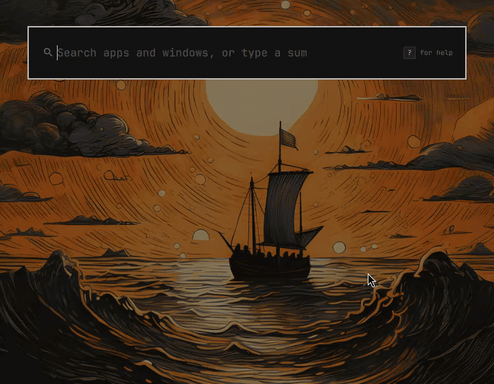

<p align="center">
  
</p>

<h1 align="center">Command Bar</h1>

<p align="center">
  <b>A Spotlight-style command bar for Omarchy.</b><br>
  Open apps, switch windows, find files, do maths, convert currencies and units, check time zones,
  find emoji and symbols, quit processes and ask your AI agent, all from <b>Super + Period</b>.
</p>

<p align="center">
  <a href="https://plugins.omarchy.org/plugin.html?id=io.github.saikomantisu.commandbar"><picture><source media="(prefers-color-scheme: dark)" srcset="https://shieldcn.dev/badge/Omarchy-plugin-18181b.svg?logo=omarchy&variant=secondary&mode=dark" /></picture></a>
  <a href="manifest.json"><picture><source media="(prefers-color-scheme: dark)" srcset="https://shieldcn.dev/badge/dynamic/json.svg?url=https%3A%2F%2Fraw.githubusercontent.com%2FSaikomantisu%2Fomarchy-commandbar%2Fmain%2Fmanifest.json&query=%24.version&label=version&logo=false&variant=secondary&mode=dark" /></picture></a>
  <a href="https://github.com/Saikomantisu/omarchy-commandbar/stargazers"><picture><source media="(prefers-color-scheme: dark)" srcset="https://shieldcn.dev/github/stars/Saikomantisu/omarchy-commandbar.svg?variant=secondary&mode=dark" /></picture></a>
  <a href="LICENSE"><picture><source media="(prefers-color-scheme: dark)" srcset="https://shieldcn.dev/github/license/Saikomantisu/omarchy-commandbar.svg?variant=secondary&mode=dark" /></picture></a>
  <a href="https://ko-fi.com/ravinathr"><picture><source media="(prefers-color-scheme: dark)" srcset="https://shieldcn.dev/badge/Ko--fi-support-18181b.svg?logo=kofi&variant=secondary&mode=dark" /></picture></a>
</p>

<p align="center">
  <a href="#install">Install</a> ·
  <a href="#features">Features</a> ·
  <a href="#why-command-bar">Why Command Bar</a> ·
  <a href="#configure">Configure</a> ·
  <a href="#privacy">Privacy</a> ·
  <a href="#contributing">Contributing</a>
</p>

## Install

```sh
omarchy plugin add https://github.com/Saikomantisu/omarchy-commandbar --enable
```

Then press **Super + Period** to open it. Everything it needs comes with Omarchy.

## Features

| Feature | Try typing |
|---------|------------|
| Calculator | `12*8 + 15%` |
| Currency | `100 usd to eur` |
| Units | `5 km to mi` |
| Time zones | `time in tokyo` |
| Dates | `days until dec 25` |
| Apps and windows | `browser`, `w term` |
| Files | `.pdf` to search by name, `~/Downloads/` to browse (Tab goes into a folder) |
| Emoji and symbols | `:fire`, `:arrow`, `:degree` |
| Processes | `kill chrome` |
| Web addresses | `example.com`, `localhost:3000` |
| UUIDs, hashes, encoding | `uuid`, `sha256 hello`, `base64 hello` |
| Your AI agent | `ai why is my wifi slow` |
| Keyword commands | `g …`, `yt …`, or your own |

Type `?` in the bar for help and examples for every feature.

## Why Command Bar

Omarchy already has an emoji picker, a calculator and an agent picker, each on its own key. I wanted one key for all of that, plus currency, time zones, units, windows and killing processes. Command Bar is that key. It sits on Super + Period, leaves the menu on Super + Space alone and needs nothing Omarchy doesn't already ship.

It isn't going anywhere. It has tests, and each release goes through the Omarchy marketplace's verification before it shows up there. There have been six releases since 1.0 on 24 September.

If you'd rather replace the Omarchy menu itself, [Keystroke](https://github.com/evindor/keystroke) does that.

## Configure

Put your settings in `~/.config/omarchy/extensions/commandbar.json`. They override the defaults in [`config.default.json`](config.default.json), and changes apply when you save.

```jsonc
{
  "hotkey": "SUPER + PERIOD",
  "currency": { "home": "EUR", "favorites": ["USD", "GBP"] }
}
```

If you set your own `"providers"` list, add `"files"`, `"url"` and `"generate"` to it to get the features added in 1.4.0.

> [!WARNING]
> `ai` starts your Omarchy agent with its auto-approve setting, so the agent runs commands without asking. The row says so before you press Enter.

## Privacy

- The only network request is for exchange rates, at most once a day. What you type isn't sent anywhere, except web keyword searches like `g` and prompts you give your agent with `ai`.
- File search and browsing run `fd` only while files are on screen. They read file names, not their contents. Searching by name covers your home folder and leaves out hidden files; browsing lists the folder you type.
- A typed web address opens only when you press Enter, and only `http` and `https` addresses open.
- It writes only to `~/.cache/omarchy-commandbar/` and never changes your Hyprland or Omarchy config files.
- Its hotkey is set in the running Hyprland and removed with the plugin.

## Remove

```sh
omarchy plugin remove io.github.saikomantisu.commandbar
rm -rf ~/.cache/omarchy-commandbar ~/.config/omarchy/extensions/commandbar.json
```

## Contributing

See [CONTRIBUTING.md](CONTRIBUTING.md).

## License

[MIT](LICENSE)
